# 🛠️ DX11 기반 ECS 아키텍처 캐시 최적화 렌더러 (c_cpp/PardCode34)

> **C++17 · Direct3D 11 · HLSL · DirectXMath · Assimp · ImGui**  
> **개인 프로젝트 | 2025.05 ~ 개발 중**  
> 코드: [`C_CPP/PardCode34`](https://github.com/ckdlscjs/c_cpp/tree/main/C_CPP/PardCode34) · [기술 학습 기록](https://blog.naver.com/syl610/224314221774)

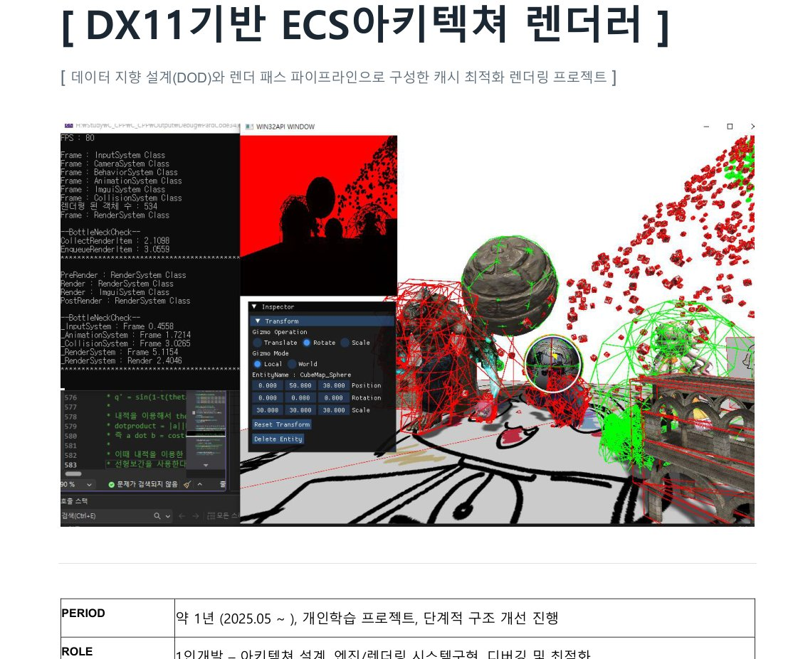

> 원본: 기술스택 및 포트폴리오 PDF, p.2.

## 00. 프로젝트 소개

단순히 렌더링 결과를 구현하는 것보다 **데이터 배치·자원 소유권·렌더 상태 전환이 성능에 미치는 영향**을 직접 다루기 위해 시작한 Direct3D 11 기반 렌더러입니다. 이전 DX11 게임·맵툴 프로젝트에서 경험했던 객체별 자원 소유, 산발적인 메모리 배치, 잦은 파이프라인 바인딩 문제를 개선하는 방향으로 구조를 단계적으로 발전시켰습니다.

핵심 설계 축은 **① CRTP/RAII 기반 엔진 시스템 → ② Archetype/Chunk 기반 ECS → ③ 64비트 정렬 키 기반 RenderQueue → ④ 그래픽스 렌더패스와 GPU 피킹**입니다.

> 이 문서는 개발 목적과 설계 근거를 먼저 설명하고, 각 구현 항목을 실제 GitHub 소스에 연결합니다. 아래의 성능 관련 설명은 구조적 기대 효과이며, 별도 벤치마크 수치가 없는 항목은 측정 성능으로 주장하지 않습니다.

## 주요 구현 요약

| 영역 | 주요 구현 | 대표 소스 |
|---|---|---|
| 엔진 기반 | CRTP `BaseSystem`, RAII, 입력·타이머·ImGui 통합 | [`BaseSystem.h`](https://github.com/ckdlscjs/c_cpp/blob/main/C_CPP/PardCode34/BaseSystem.h) |
| 리소스 | `EngineSystem`/`ResourceSystem` 역할 분리, FNV-1a 해시 키 캐싱, Assimp 모델 로드 | [`ResourceSystem.h`](https://github.com/ckdlscjs/c_cpp/blob/main/C_CPP/PardCode34/ResourceSystem.h) · [`Geometry.h`](https://github.com/ckdlscjs/c_cpp/blob/main/C_CPP/PardCode34/Geometry.h) |
| ECS | Archetype, 컴포넌트 비트셋, 16KB Chunk, Sparse/Dense 조회, Swap & Pop | [`ECSSystem.h`](https://github.com/ckdlscjs/c_cpp/blob/main/C_CPP/PardCode34/ECSSystem.h) · [`Archetype.h`](https://github.com/ckdlscjs/c_cpp/blob/main/C_CPP/PardCode34/Archetype.h) |
| 렌더링 | RenderItem 수집, 64비트 Sort Key, 인스턴싱, XOR 차분 바인딩 | [`RenderSystem.cpp`](https://github.com/ckdlscjs/c_cpp/blob/main/C_CPP/PardCode34/RenderSystem.cpp) |
| 렌더패스 | Deferred/G-Buffer, Shadow/PCF, CubeMap, Outline, Forward·Debug | [`RenderSystem.cpp`](https://github.com/ckdlscjs/c_cpp/blob/main/C_CPP/PardCode34/RenderSystem.cpp) · [`PS_Shadows.hlsli`](https://github.com/ckdlscjs/c_cpp/blob/main/C_CPP/PardCode34/PS_Shadows.hlsli) |
| 충돌·피킹 | Frustum/BV 테스트, Ray/Triangle, Compute Shader 스키닝·정밀 교차 | [`CollisionSystem.cpp`](https://github.com/ckdlscjs/c_cpp/blob/main/C_CPP/PardCode34/CollisionSystem.cpp) · [`CS_Collision_Triangle.hlsl`](https://github.com/ckdlscjs/c_cpp/blob/main/C_CPP/PardCode34/CS_Collision_Triangle.hlsl) |

## 1. 전체 아키텍처

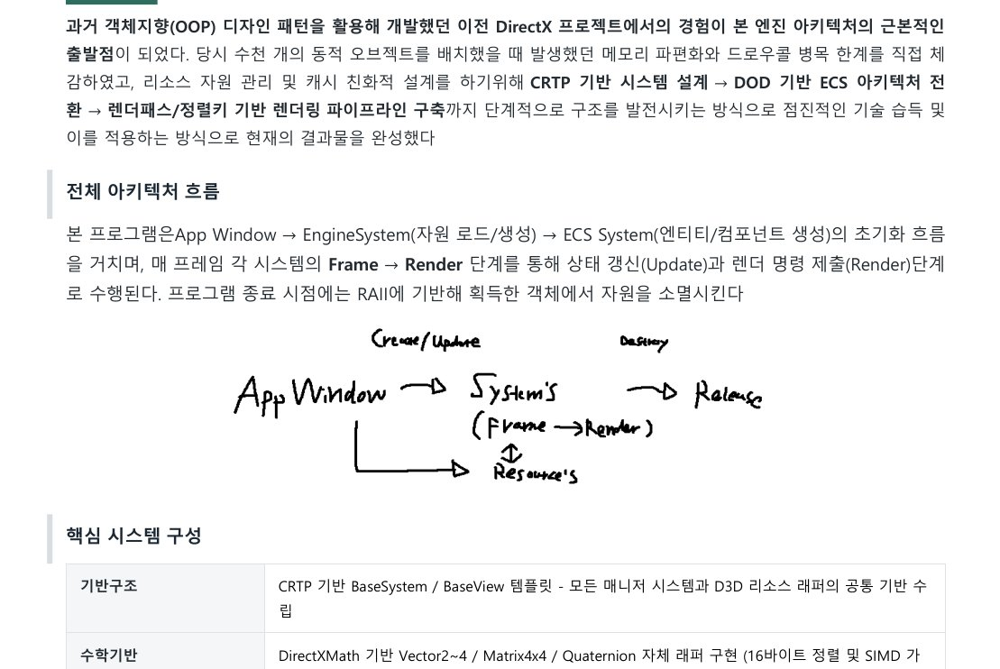

*PDF p.3의 원본 아키텍처 도식. 아래 Mermaid 도식은 이를 읽기 쉽게 재구성한 것입니다.*


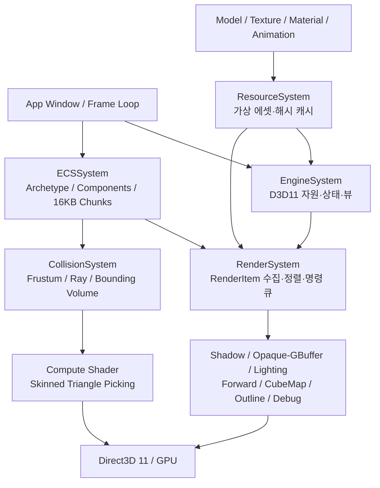

설계상 **에셋 원본·가공 데이터(ResourceSystem)**와 **D3D11 물리 자원(EngineSystem)**, 그리고 **렌더 명령의 생성·실행(RenderSystem)**을 구분합니다. 각 객체가 리소스를 독립 소유하지 않고 해시 키를 통해 공유하게 하여 중복 생성과 상태 변경을 제어합니다.

**관련 코드:** [`ResourceSystem.h`](https://github.com/ckdlscjs/c_cpp/blob/main/C_CPP/PardCode34/ResourceSystem.h), [`RenderSystem.cpp`](https://github.com/ckdlscjs/c_cpp/blob/main/C_CPP/PardCode34/RenderSystem.cpp)

## 2. 엔진 기반 시스템과 에셋 파이프라인

### CRTP / RAII

각 매니저의 싱글톤 보일러플레이트를 `BaseSystem<T>`로 공통화하고, 최초 접근 시 함수 지역 정적 객체를 구성하도록 설계했습니다. D3D11 리소스는 소유/해제 책임을 명확하게 구분하여 수명을 관리합니다.

- [`BaseSystem.h`](https://github.com/ckdlscjs/c_cpp/blob/main/C_CPP/PardCode34/BaseSystem.h) — 시스템 인스턴스 접근·생명주기
- [`CommonMath.h`](https://github.com/ckdlscjs/c_cpp/blob/main/C_CPP/PardCode34/CommonMath.h) — DirectXMath 래퍼(Vector/Matrix/Quaternion)
- [`ResourceSystem.h`](https://github.com/ckdlscjs/c_cpp/blob/main/C_CPP/PardCode34/ResourceSystem.h) — 캐싱 팩토리와 가상 에셋 관리
- [`Geometry.h`](https://github.com/ckdlscjs/c_cpp/blob/main/C_CPP/PardCode34/Geometry.h) — Assimp 기반 기하 데이터

### 리소스 처리 흐름

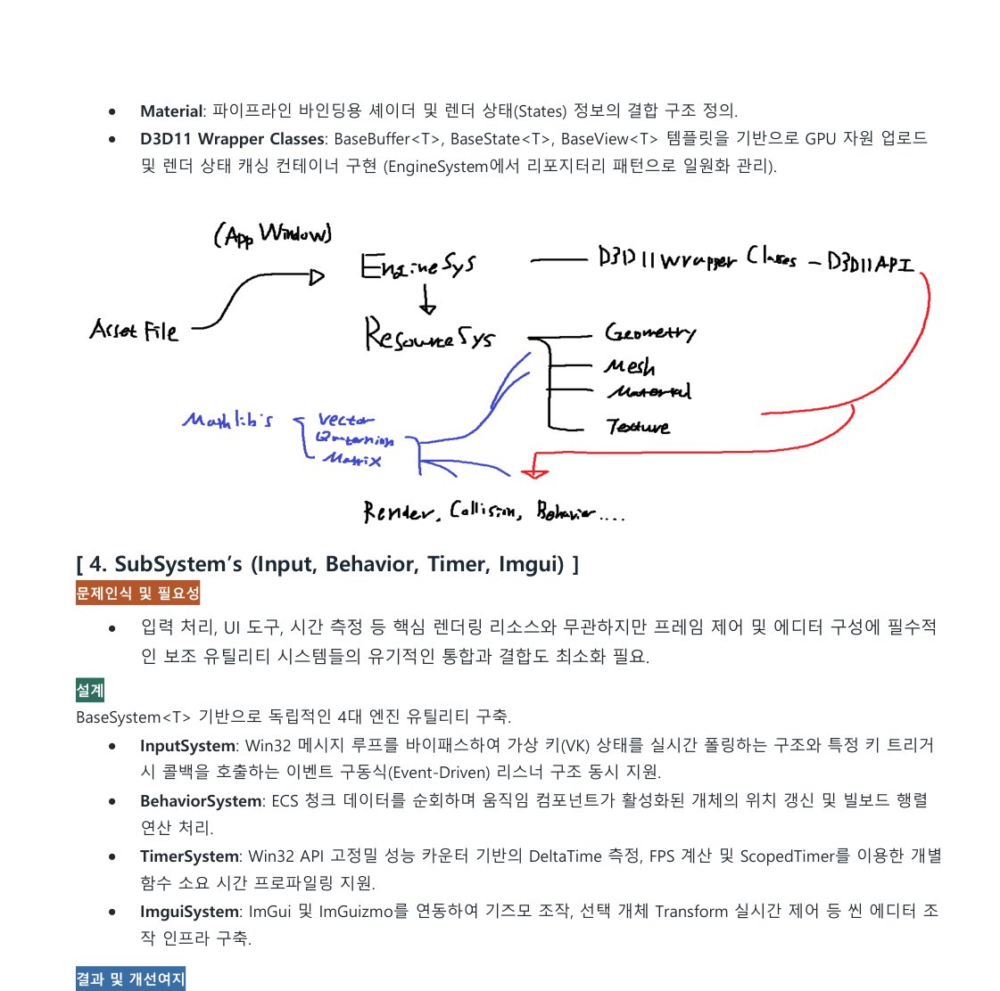

*PDF p.5: 개발 당시 작성한 자원 관리 흐름도.*


해시맵 조회의 평균 시간복잡도는 O(1)이지만, **충돌 비용과 해시 계산을 포함한 실제 동작은 항상 상수시간이 보장되는 것은 아닙니다.** 성능 표현은 '평균 O(1) 조회를 활용한 중복 로드 방지'가 적절합니다.

## 3. 데이터 지향 ECS

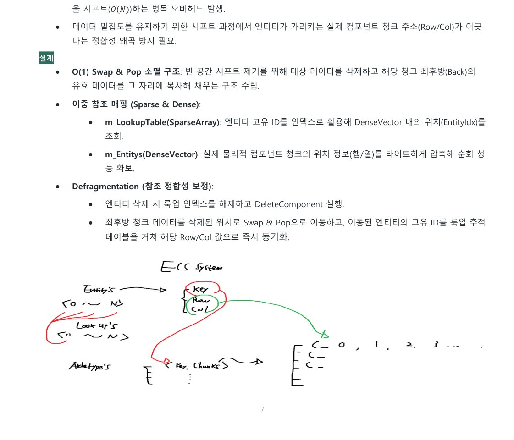

*PDF p.7: 아키타입, 청크 데이터와 엔티티 위치 관리 도식.*

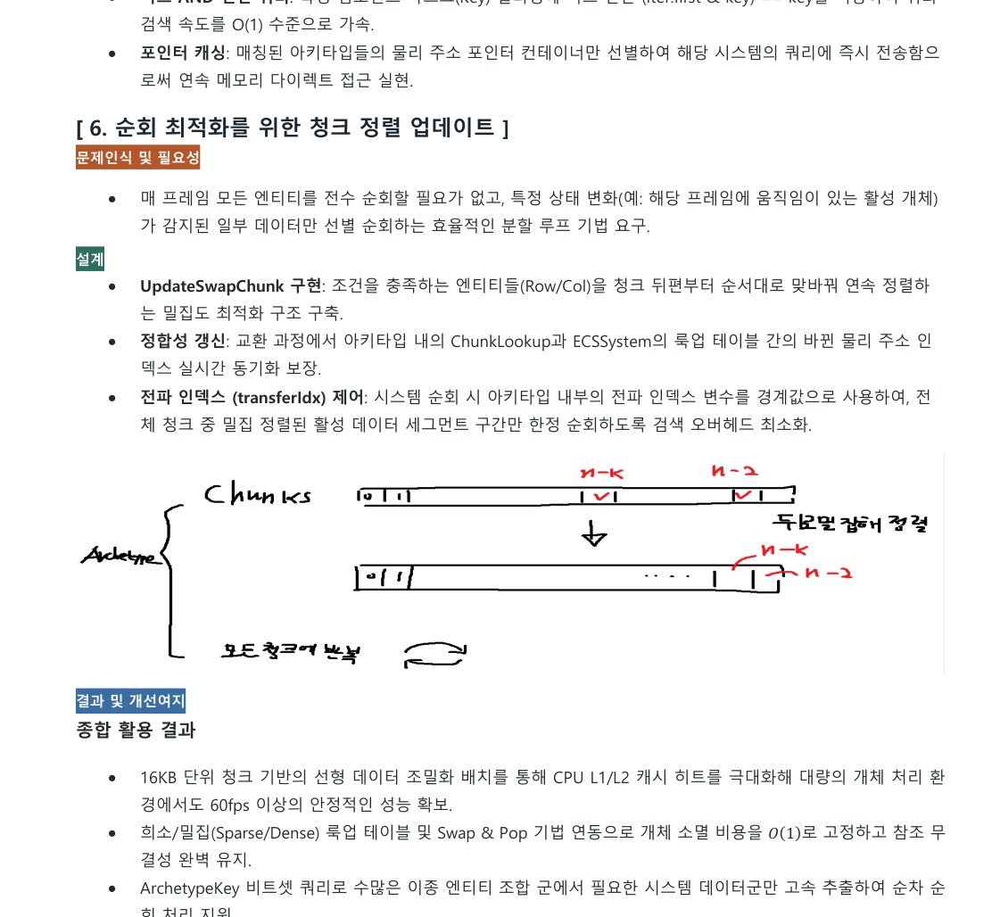

*PDF p.8: 비트셋 검색과 활성 데이터 구간 재정렬의 원본 도식.*


### 도입 배경

기존 OOP 객체를 매 프레임 개별 순회하는 방식에서 포인터 추적·데이터 분산에 따른 캐시 비친화성이 나타날 수 있습니다. 이에 따라 Entity를 식별자, Component를 데이터, System을 연산 주체로 분리하고 동일한 컴포넌트 조합을 Archetype으로 묶었습니다.

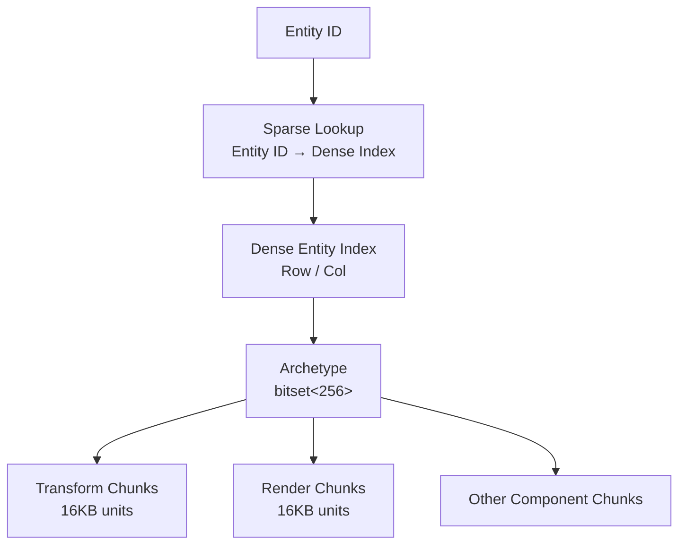

- **ArchetypeKey:** `std::bitset<256>`를 통한 컴포넌트 조합 표현
- **16KB Chunk:** 각 컴포넌트 타입을 연속된 메모리 구간에 저장
- **Sparse/Dense:** Entity ID와 실제 컴포넌트 위치를 매핑
- **Swap & Pop:** 삭제 시 마지막 유효 데이터를 빈 슬롯으로 이동해 밀집도를 유지하고 매핑을 보정
- **QueryArchetypes:** 비트마스크로 조건을 검사하고 일치하는 아키타입을 수집

**코드 리뷰 바로가기:** [`CreateArchetype`](https://github.com/ckdlscjs/c_cpp/blob/main/C_CPP/PardCode34/ECSSystem.h) · [`Archetype/Chunk`](https://github.com/ckdlscjs/c_cpp/blob/main/C_CPP/PardCode34/Archetype.h) · [`QueryArchetypes / UpdateSwapChunk`](https://github.com/ckdlscjs/c_cpp/blob/main/C_CPP/PardCode34/ECSSystem.cpp)

> **복잡도 설명:** 각 아키타입의 비트마스크 포함 여부 검사는 고정 폭 비트셋 기준 저비용 연산이지만, `QueryArchetypes` 자체는 등록된 아키타입을 순회하므로 아키타입 개수 A에 대해 O(A)입니다. Swap & Pop의 기본 삭제/치환은 상수 개수의 위치 변경으로 구현되지만 참조 보정·컴포넌트 수에 따른 비용을 별도로 고려해야 합니다.

## 4. RenderQueue와 64비트 정렬 키

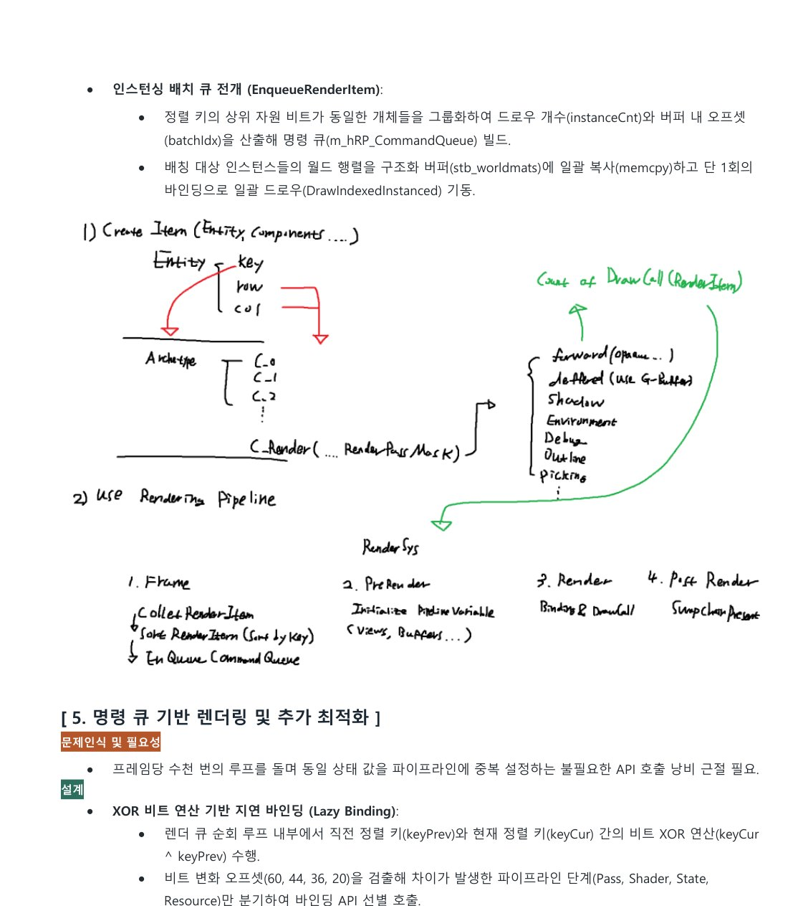

*PDF p.11의 실제 설계 및 RenderItem 수집/명령 큐 전개 도식.*


### 문제와 접근

Archetype 순회만으로는 같은 셰이더·렌더 상태·메시를 사용하는 개체가 인접한다는 보장이 없습니다. RenderItem을 패스별로 수집하고, 파이프라인 상태 변경 비용이 큰 항목부터 정렬 키에 배치해 정렬 후 제출하도록 구성했습니다.

### 정렬 키 레이아웃

```text
  63                         0
  ┌────────┬────────────────┬────────┬────────────────┬────────────────────┐
  │ Pass   │ Shaders        │ States │ Resources      │ Distance           │
  │ 4 bits │ 16 bits        │ 8 bits │ 16 bits        │ 20 bits            │
  └────────┴────────────────┴────────┴────────────────┴────────────────────┘
```

- **Pass:** 렌더 타겟·파이프라인 단계 분류
- **Shaders/States/Resources:** 원래의 해시를 그대로 삽입하지 않고 별도의 압축 ID를 발급
- **Distance:** 깊이 정렬에 사용. 불투명·투명 오브젝트의 정렬 요구는 별도로 고려

### 렌더링 명령 흐름


인스턴싱 배치 시 같은 메시·머티리얼을 공유하는 개체의 월드 행렬을 GPU 버퍼로 수집하고 `DrawIndexedInstanced` 호출에 활용합니다. 인접한 키 간 XOR 차분으로 Pass/Shader/State/Resource 변경 지점을 식별합니다.

**코드 리뷰:** [`RenderSystem.cpp`](https://github.com/ckdlscjs/c_cpp/blob/main/C_CPP/PardCode34/RenderSystem.cpp)

> **검증 포인트:** 실제 DrawCall 감소율·CPU 제출 시간·상태 바인딩 횟수는 비교 계측 결과를 확보한 뒤 숫자로 제시하는 것이 좋습니다. 정렬 키가 있다고 해서 모든 상황에서 항상 더 빠르거나 모든 배칭이 가능한 것은 아닙니다.

## 5. 렌더링 파이프라인

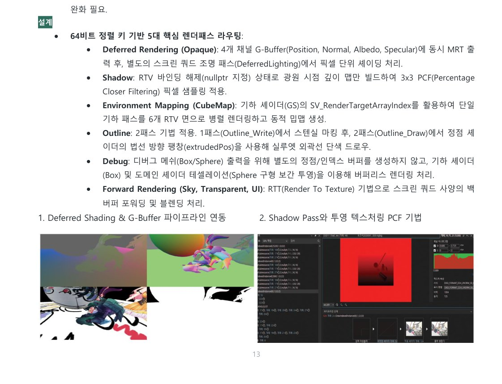

*PDF p.13: G-Buffer와 Shadow Pass 실행 결과.*

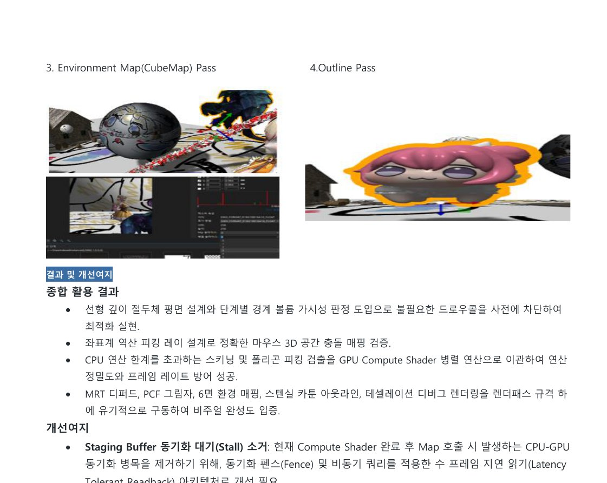

*PDF p.14: CubeMap 및 Outline Pass 실행 결과.*


| 패스 | 구현 의도 | 주요 기법 |
|---|---|---|
| Opaque | 불투명 지오메트리와 조명 단계 분리 | MRT / G-Buffer / Deferred Shading |
| Shadow | 광원 시점 깊이 기록 | Shadow Map / 3×3 PCF |
| Forward | 투명 객체·UI 등 별도 처리 | Blending / Forward Rendering |
| CubeMap | 환경 텍스처 갱신 | Cubemap Render Targets / GS 활용 |
| Outline | 선택 객체 실루엣 | Stencil + Normal Extrusion |
| Debug | 디버깅 기하 표시 | Box/Sphere 관련 셰이더·기하 처리 |

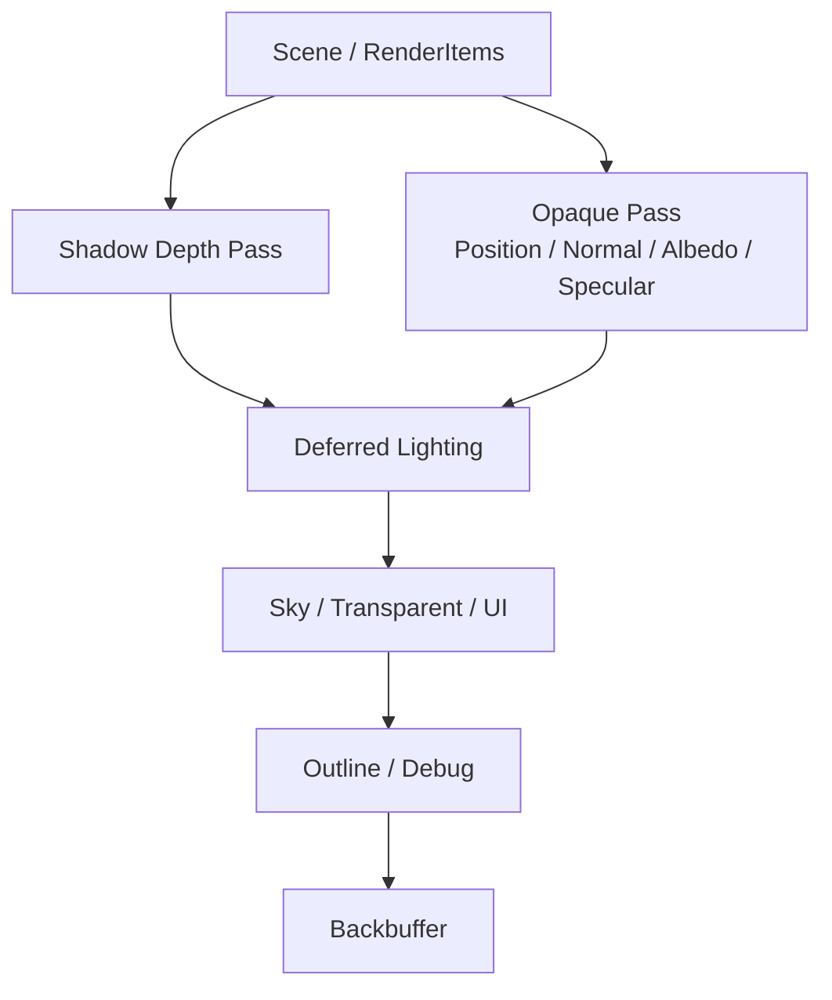

### Deferred Shading

불투명 메시의 기하 정보를 Position, Normal, Albedo, Specular G-Buffer로 MRT 출력하고, 이후 화면 공간 Lighting 단계에서 재활용합니다. 투명 객체는 해당 G-Buffer 경로와 구분하여 Forward 경로로 처리합니다.

### Shadow Mapping

깊이 전용 패스에서 RTV 대신 DSV를 사용해 광원 깊이 지도를 생성하고, 픽셀 셰이더에서 비교 샘플러와 3×3 PCF를 활용합니다.

- [`RenderSystem.cpp`](https://github.com/ckdlscjs/c_cpp/blob/main/C_CPP/PardCode34/RenderSystem.cpp)
- [`PS_Shadows.hlsli`](https://github.com/ckdlscjs/c_cpp/blob/main/C_CPP/PardCode34/PS_Shadows.hlsli)

## 6. 가시성·충돌·GPU 피킹

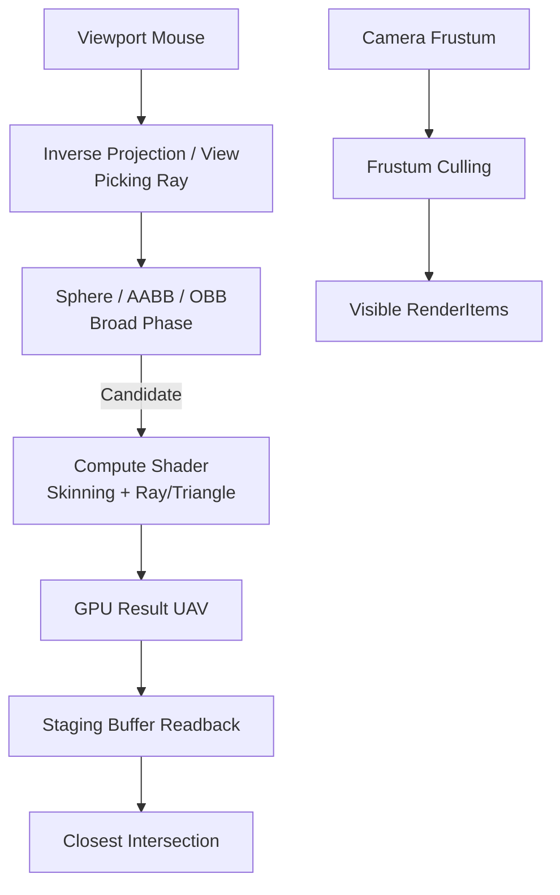

충돌 후보를 경계 볼륨 검사로 줄이고, 정밀 Triangle Picking은 HLSL Compute Shader에서 Möller–Trumbore 교차 검사와 스키닝 변형을 수행하도록 구성했습니다. 결과를 GPU 버퍼에 기록한 뒤 Staging 자원을 통해 CPU로 읽어 옵니다.

- [`CollisionSystem.cpp`](https://github.com/ckdlscjs/c_cpp/blob/main/C_CPP/PardCode34/CollisionSystem.cpp)
- [`CS_Collision_Triangle.hlsl`](https://github.com/ckdlscjs/c_cpp/blob/main/C_CPP/PardCode34/CS_Collision_Triangle.hlsl)

> **개선 여지:** GPU→CPU 동기식 `Map`/Readback에는 스톨이 발생할 수 있습니다. 후속 개선안은 지연 읽기, 비동기 쿼리, 결과 소비 시점 분리 등으로 명확히 기재합니다.

## 7. 주요 설계 선택과 트레이드오프

| 설계 선택 | 얻는 것 | 감수하는 것 / 검증할 점 |
|---|---|---|
| CRTP 기반 매니저 | 반복 코드 축소·수명 경계 명확화 | 전역 접근 패턴의 결합도 관리 |
| FNV-1a 해시 캐시 | 중복 로드·조회 처리 일원화 | 해시 충돌·데이터 정합성·소유권 검증 |
| 16KB Chunk ECS | 데이터 지역성·밀집 순회 | 구조 변경·엔티티 이동 시 복잡도 |
| Swap & Pop | 중간 요소 시프트 감소 | 순서 불안정·역참조 갱신 필수 |
| 64비트 Sort Key | 상태 변경 최소화 시도 | 깊이 정렬과 상태 배칭 우선순위 충돌 |
| GPU Triangle Picking | 정점 변형·삼각형 검사 병렬화 | Readback 지연·동기화 오버헤드 |
| Deferred Shading | 기하/조명 단계 분리 | G-Buffer 메모리·대역폭·투명 처리 |

## 8. PDF 원본 이미지 및 구현 결과

다음 이미지는 첨부된 포트폴리오 PDF의 **렌더러 관련 2~14쪽**에서 발췌한 원본 자료입니다. 전체 화면과 개별 렌더패스의 결과 이미지는 위 각 구현 섹션에도 배치했습니다.

| 내용 | PDF 원본 페이지 | README 위치 |
|---|---|---|
| 렌더러 실행 화면 | 2쪽 | 프로젝트 소개 |
| 프레임/엔진 아키텍처 | 3쪽 | 전체 아키텍처 |
| 엔진·리소스 관리 설계 | 5쪽 | 리소스 처리 흐름 |
| Archetype/Chunk 및 Sparse/Dense | 7~8쪽 | ECS |
| RenderQueue 생성·처리 흐름 | 11쪽 | RenderQueue |
| Deferred·Shadow 렌더링 결과 | 13쪽 | 렌더링 파이프라인 |
| CubeMap·Outline 결과 | 14쪽 | 렌더링 파이프라인 |

이미지 파일은 `docs/images/` 아래에 포함되어 있습니다. PDF 페이지에서 잘라낸 자료이므로 해상도 향상이 필요하면 원본 캡처 이미지로 교체할 수 있습니다.

## 9. 남은 과제 및 검증 계획

- **정량 프로파일링:** 동일 씬 기준 ECS 순회 시간, DrawCall 수, RenderQueue 생성·정렬 비용, API 상태 변경 횟수 측정
- **멀티스레드:** 컴포넌트 Read/Write 종속성을 바탕으로 시스템 작업 분배 가능성 검토
- **리소스 로딩:** 에셋 사전 직렬화 및 비동기 로드 경로 검토
- **렌더 최적화:** 월드 행렬의 변경 감지(Dirty Flag) 캐싱과 CPU↔GPU 동기화 비용 분석
- **가시성:** 공간 분할(Octree 등) 적용 가능성 검토

> **주의:** 위 목록은 현재 구현 완료 기능이 아니라 향후 개선·검증 대상입니다.

## 10. 상세 소스 코드 리뷰 — 기존 README 핵심 구현 유지

이 절은 기존 README의 장점인 **핵심 구현 코드, 함수별 의도, 실제 소스 경로**를 중심으로 구성합니다. 아래 코드는 설명에 필요한 부분을 중심으로 발췌했으며 정확한 최신 정의는 링크된 `main` 브랜치의 파일을 기준으로 확인할 수 있습니다.

### 10.1 `BaseSystem<T>` — CRTP / 매니저 수명 관리

- **소스:** [`BaseSystem.h`](https://github.com/ckdlscjs/c_cpp/blob/main/C_CPP/PardCode34/BaseSystem.h)
- **문제:** 엔진 내부 매니저마다 생성/복사 금지·접근자·소멸 관리 코드를 중복 작성해야 했습니다.
- **구현:** 템플릿 기반 공통 진입점과 함수 지역 `static T`를 이용해 매니저 인스턴스를 지연 초기화했습니다.

```cpp
template<typename T>
class BaseSystem {
protected:
    BaseSystem();
    virtual ~BaseSystem();
    BaseSystem(const BaseSystem&) = delete;
    BaseSystem& operator=(const BaseSystem&) = delete;
    BaseSystem(BaseSystem&&) = delete;
public:
    static T& GetInstance();
};

template<typename T>
inline T& BaseSystem<T>::GetInstance() {
    static T instance;
    return instance;
}
```

> 이 구조는 C++11 이후 함수 지역 정적 객체의 **초기화가 스레드 안전**하다는 성질을 이용합니다. 반면 반환한 객체에 대한 개별 메서드의 동시 호출까지 자동으로 안전해지는 것은 아닙니다.

### 10.2 `CommonMath` — SIMD 대응 수학 래퍼

- **소스:** [`CommonMath.h`](https://github.com/ckdlscjs/c_cpp/blob/main/C_CPP/PardCode34/CommonMath.h)
- **문제:** DirectXMath의 벡터/행렬 타입은 연산에 적합하지만 디버깅 시 개별 요소 접근과 상위 코드의 사용성이 불편했습니다.
- **구현:** Vector/Matrix/Quaternion 래퍼에 16바이트 정렬, 연산자 오버로드, 개별 행렬 원소 접근, Slerp 관련 연산을 추가했습니다.

```cpp
__declspec(align(16)) struct Vector4 {
    Vector4() : m_vec(DirectX::XMVectorZero()) {}
    Vector4(float x, float y, float z, float w)
        : m_vec(DirectX::XMVectorSet(x, y, z, w)) {}
    DirectX::XMVECTOR ToXMVECTOR() const { return m_vec; }
private:
    DirectX::XMVECTOR m_vec;
};
```

관련 구현은 카메라 Transform, Frustum, Collision, Animation 보간 등에서 공유합니다. 저장 형식 및 정렬 요구 사항은 소스의 실제 선언을 기준으로 확인해야 합니다.

### 10.3 `ResourceSystem::CreateResource` — 가상 자원 생성과 해시 캐시

- **소스:** [`ResourceSystem.h`](https://github.com/ckdlscjs/c_cpp/blob/main/C_CPP/PardCode34/ResourceSystem.h), [`Geometry.h`](https://github.com/ckdlscjs/c_cpp/blob/main/C_CPP/PardCode34/Geometry.h)
- **문제:** 동일한 텍스처·Geometry를 객체별로 다시 읽고 GPU 자원을 매번 생성하는 구조는 로딩 시간과 메모리 사용에 불리합니다.
- **구현:** 리소스 이름/경로를 해시 키로 변환하고 기존 등록 객체를 재사용합니다. Assimp는 노드 계층을 순회하며 메시/애니메이션 정보를 가공합니다.

```cpp
template<typename T, typename... Types>
T* ResourceSystem::CreateResource(const std::wstring& szFile, Types&&... args) {
    size_t hash = Hasing_wstring(szFile);
    if (m_Resources.find(hash) != m_Resources.end())
        return static_cast<T*>(m_Resources[hash]);

    T* newResource = new T(hash, szFile, std::forward<Types>(args)...);
    m_Resources[hash] = newResource;
    return newResource;
}
```

**설계상 주의:** 해시맵의 평균 조회 비용이 낮다는 점과 파일 로드·해시 계산·GPU 생성까지 O(1)이라는 주장은 다릅니다. 해시 충돌과 객체 소유권 정합성도 별도로 확인할 항목입니다.

### 10.4 `CreateArchetype` — 컴포넌트 조합과 청크 생성

- **소스:** [`ECSSystem.h`](https://github.com/ckdlscjs/c_cpp/blob/main/C_CPP/PardCode34/ECSSystem.h), [`Components.h`](https://github.com/ckdlscjs/c_cpp/blob/main/C_CPP/PardCode34/Components.h)
- **설계 의도:** Entity를 ID로, Component를 데이터로, System을 연산 주체로 분리합니다. 동일 조합의 Component를 Archetype에 묶고 16KB 청크로 분할해 데이터 지역성을 고려했습니다.

```cpp
template<typename ...Comps>
inline ArchetypeKey ECSSystem::CreateArchetype() {
    ArchetypeKey key = GetArchetypeKey<Comps...>();
    if (m_Archetypes.find(key) != m_Archetypes.end())
        return key;

    m_Archetypes[key] = new Archetype(GetMaxComponentSize<Comps...>());
    (m_Archetypes[key]->RegisterComponent<Comps>(), ...);
    return key;
}
```

- **C++17 폴드 표현식:** 템플릿 매개변수로 전달한 컴포넌트 타입마다 등록 함수를 전개합니다.
- **ArchetypeKey:** 컴포넌트 조합을 고정 폭 비트셋으로 표현합니다.
- **ChunkData:** 청크의 실제 데이터 저장과 Swap/SwapAndPop 동작을 맡습니다.

### 10.5 `Archetype::DeleteComponent` / `ECSSystem::DeleteEntity` — Sparse/Dense + Swap & Pop

- **소스:** [`Archetype.h`](https://github.com/ckdlscjs/c_cpp/blob/main/C_CPP/PardCode34/Archetype.h), [`ECSSystem.cpp`](https://github.com/ckdlscjs/c_cpp/blob/main/C_CPP/PardCode34/ECSSystem.cpp)
- **문제:** 선형 배열의 중간 요소 제거 시 뒤쪽 요소를 모두 시프트하면 빈번한 생성·삭제 과정에서 비용이 증가합니다.
- **구현:** 마지막 데이터를 삭제 슬롯으로 이동한 다음 끝 데이터를 제거하고, 이동된 Entity ID에 대한 행/열·밀집 인덱스 매핑을 보정합니다.

```cpp
// Archetype: 컴포넌트별 데이터에 동일한 교환·삭제 정책을 적용
for (const auto& key : m_ComponentsLookup)
    m_Components[key][idxRow]->SwapAndPop(
        idxCol, m_Components[key].back());

// ECSSystem: 이동한 엔티티의 실제 컴포넌트 위치 보정
if (movedLookupIdx != lookupIdx) {
    size_t movEntityIdx = FindEntity(movedLookupIdx);
    m_Entitys[movEntityIdx].m_IdxRow = delEntity.m_IdxRow;
    m_Entitys[movEntityIdx].m_IdxCol = delEntity.m_IdxCol;
}
```

기본 Swap & Pop 동작은 시프트 비용을 없애지만 실제 삭제에는 **구성 컴포넌트의 수, 룩업 테이블 보정, 청크 해제**가 포함됩니다. 따라서 전체 작업을 무조건 O(1)이라고 단정하지 않습니다.

### 10.6 `QueryArchetypes` / `UpdateSwapChunk` — 비트마스크 검색과 활성 데이터 재배치

- **소스:** [`ECSSystem.cpp`](https://github.com/ckdlscjs/c_cpp/blob/main/C_CPP/PardCode34/ECSSystem.cpp)
- **기능:** 시스템이 필요로 하는 컴포넌트 조합을 필터링한 뒤, 활성 데이터만 조밀한 세그먼트로 재배치해 필요한 범위의 순회를 지원합니다.

```cpp
std::vector<Archetype*> ECSSystem::QueryArchetypes(ArchetypeKey key) {
    std::vector<Archetype*> archetypes;
    for (auto& iter : m_Archetypes) {
        if ((iter.first & key) == key && !iter.second->IsEmpty())
            archetypes.push_back(iter.second);
    }
    return archetypes;
}
```

전체 아키타입을 순회하므로 쿼리 탐색은 등록된 아키타입 수에 비례합니다. `UpdateSwapChunk`는 행/열 위치를 스왑한 뒤 `transfer_row`, `transfer_col` 등을 갱신하여 활성 데이터 범위를 관리합니다. [원본 구현](https://github.com/ckdlscjs/c_cpp/blob/main/C_CPP/PardCode34/ECSSystem.cpp)을 참조하세요.

### 10.7 64비트 RenderPass Sort Key — 서브 ID 발급 및 비트 패킹

- **소스:** [`RenderSystem.cpp`](https://github.com/ckdlscjs/c_cpp/blob/main/C_CPP/PardCode34/RenderSystem.cpp)
- **서브 키:** `GetRenderPassKey_Shaders`, `GetRenderPassKey_States`, `GetRenderPassKey_Resources`
- **조립:** `GenerateRenderPassHash`

```cpp
_RPKey RenderSystem::GenerateRenderPassHash(
    uint32_t hashPass, uint32_t hashShaders,
    uint32_t hashStates, uint32_t hashResources,
    uint32_t hashDist)
{
    _RPKey key = 0;
    key |= (static_cast<uint64_t>(hashPass) & 0xF) << 60;
    key |= (static_cast<uint64_t>(hashShaders) & 0xFFFF) << 44;
    key |= (static_cast<uint64_t>(hashStates) & 0xFF) << 36;
    key |= (static_cast<uint64_t>(hashResources) & 0xFFFF) << 20;
    if (static_cast<uint32_t>(E_RenderPass::Transparent) == hashPass)
        hashDist = 0xFFFFF - hashDist;
    key |= static_cast<uint64_t>(hashDist) & 0xFFFFF;
    return key;
}
```

최상위 `Pass`→`Shader`→`State`→`Resource`→`Distance` 순서로 정렬 우선순위를 부여합니다. 이 방식은 서로 다른 패스 간 타깃 전환을 그룹화하고, 동일 리소스를 쓰는 Draw 항목이 인접하도록 돕습니다. 투명 패스는 뒤에서 앞으로 정렬하도록 거리 부분을 반전합니다.

### 10.8 `CollectRenderItem` / `EnqueueRenderItem` — 인스턴싱 배치 큐

- **소스:** [`RenderSystem.cpp`](https://github.com/ckdlscjs/c_cpp/blob/main/C_CPP/PardCode34/RenderSystem.cpp)
- **수집:** ECS의 `C_Transform`과 `C_Render` 컴포넌트, `passMasks`, 가시성 상태를 확인해 드로우 후보를 생성합니다.
- **큐 구성:** 정렬된 키의 리소스 영역이 같은 개체를 그룹화하고, 월드 행렬을 구조화 버퍼에 저장한 뒤 `DrawIndexedInstanced`를 호출합니다.

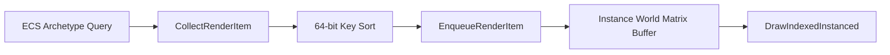

**배칭 조건:** 동일 상태가 서로 인접한다고 항상 하나의 인스턴싱 드로우로 합칠 수는 없습니다. 메시·머티리얼·바인딩 리소스와 인스턴스 데이터 레이아웃의 일치가 필요합니다.

### 10.9 `ExecuteRenderPass` — XOR 차분 기반 Lazy Binding

- **소스:** [`RenderSystem.cpp`](https://github.com/ckdlscjs/c_cpp/blob/main/C_CPP/PardCode34/RenderSystem.cpp)
- **문제:** 이미 설정된 GPU 상태를 매 아이템마다 다시 API에 전달하는 중복 호출이 발생합니다.
- **구현:** 이전 정렬 키와 현재 키의 차이만 비교하여 변경된 범주의 셰이더·렌더 상태·리소스 바인딩을 수행합니다.

```cpp
_RPKey keyPrev = _HashNotInitialize;
for (const auto& renderItem : m_hRP_CommandQueue) {
    _RPKey keyCur = renderItem.sortKey;
    size_t diff = keyCur ^ keyPrev;
    uint32_t curPass = (keyCur >> 60) & 0xF;

    if (diff >> 60) {
        // 패스가 변경된 경우 렌더타깃 및 뷰포트 구성
    }
    // Shader, State, Resource 서브 필드의 변화에 따라 선택적으로 바인딩
    keyPrev = keyCur;
}
```

위 코드는 **핵심 원리 설명을 위한 부분 발췌**입니다. 실제 경계 마스크와 분기 순서는 `RenderSystem.cpp`의 구현을 확인해 주세요.

### 10.10 Frustum 및 Picking Ray — 단계적 충돌 검사

- **소스:** [`CollisionSystem.cpp`](https://github.com/ckdlscjs/c_cpp/blob/main/C_CPP/PardCode34/CollisionSystem.cpp)
- **카메라 가시성:** View/Projection 변환에서 절두체 평면을 유도하고 Bounding Volume과 검사해 렌더 후보를 줄입니다.
- **화면 피킹:** Viewport → NDC → 역투영·역뷰 변환으로 공간 레이를 구성합니다.
- **Broad Phase:** Ray–Sphere/Box 등 경계 볼륨으로 충돌 후보를 축소합니다.
- **Narrow Phase:** 후보 메시의 Triangle 단위 Möller–Trumbore 교차로 정밀 판정합니다.

### 10.11 `CS_Collision_Triangle.hlsl` — 스키닝 정점 + Triangle Picking

- **소스:** [`CS_Collision_Triangle.hlsl`](https://github.com/ckdlscjs/c_cpp/blob/main/C_CPP/PardCode34/CS_Collision_Triangle.hlsl)
- **핵심:** 입력 정점에 본 행렬/가중치를 적용해 스키닝한 위치를 계산하고, 각 삼각형에 대한 레이 교차를 독립 스레드로 수행합니다.

```hlsl
[numthreads(64, 1, 1)]
void csmain(uint3 dispatchThreadID : SV_DispatchThreadID)
{
    if (dispatchThreadID.x >= triangleCount) return;
    uint tid = dispatchThreadID.x;

    float3 wv0 = ComputeSkinning(gInputVertices[tid * 3 + 0]);
    float3 wv1 = ComputeSkinning(gInputVertices[tid * 3 + 1]);
    float3 wv2 = ComputeSkinning(gInputVertices[tid * 3 + 2]);

    float fDist = _Infinite;
    bool isHit = Intersect(vRayOrigin, vRayDir, wv0, wv1, wv2, fDist);
    gOutputResults[tid].idx = tid * 3;
    gOutputResults[tid].fDist = isHit ? fDist : _Infinite;
}
```

GPU 결과를 UAV에 저장하고 Staging Buffer로 복사한 후 `Map`으로 가져오는 경로는 CPU↔GPU 동기화 부담이 생길 수 있어 개선 항목으로 남겨 두었습니다.

### 10.12 렌더패스 세부 구현 — HLSL 및 핵심 상태 제어

| 패스 | 구현 상세 | 관련 소스 |
|---|---|---|
| Deferred (Opaque) | G-Buffer 4종 Position/Normal/Albedo/Specular MRT, 별도 라이팅 | [`RenderSystem.cpp`](https://github.com/ckdlscjs/c_cpp/blob/main/C_CPP/PardCode34/RenderSystem.cpp) |
| Shadow | 광원 깊이 지도와 3×3 PCF 비교 샘플러 | [`PS_Shadows.hlsli`](https://github.com/ckdlscjs/c_cpp/blob/main/C_CPP/PardCode34/PS_Shadows.hlsli) |
| CubeMap | Geometry Shader에서 `SV_RenderTargetArrayIndex` 설정하여 6개 면으로 라우팅 | [`GS_CubeMap_PTNTB.hlsl`](https://github.com/ckdlscjs/c_cpp/blob/main/C_CPP/PardCode34/GS_CubeMap_PTNTB.hlsl) |
| Outline | Stencil Write → 비교 후 정점 법선 방향 팽창 | [`Instanced_VS_Outline_PTN.hlsl`](https://github.com/ckdlscjs/c_cpp/blob/main/C_CPP/PardCode34/Instanced_VS_Outline_PTN.hlsl), [`PS_Outline_Draw.hlsl`](https://github.com/ckdlscjs/c_cpp/blob/main/C_CPP/PardCode34/PS_Outline_Draw.hlsl) |
| Debug | Collider Box/Sphere 데이터를 CB로 전달, Sphere는 Domain Shader에서 기하 보간 | [`DS_Debug_Sphere.hlsl`](https://github.com/ckdlscjs/c_cpp/blob/main/C_CPP/PardCode34/DS_Debug_Sphere.hlsl) |

#### Deferred / G-Buffer

```cpp
SetOM_RenderTargets({
    _EngineSystem.m_hash_Gbuffer_Position,
    _EngineSystem.m_hash_Gbuffer_Normal,
    _EngineSystem.m_hash_Gbuffer_Albedo,
    _EngineSystem.m_hash_Gbuffer_Specular
}, _EngineSystem.m_hash_DSView_Quad);
```

Opaque에서 MRT로 기록한 값을 별도 화면 공간 조명 단계에 SRV로 공급합니다. SRV/RTV 동시 바인딩 충돌을 피하기 위해 자원 역할 전환 시 바인딩 해제 순서를 관리해야 합니다.

#### Shadow / PCF

```hlsl
for (int y = -1; y <= 1; ++y) {
    for (int x = -1; x <= 1; ++x) {
        float2 offset = float2(x, y) * texelSize;
        shadow += gShadowMap.SampleCmpLevelZero(
            gSamShadow, projCoords.xy + offset, projCoords.z - bias).r;
    }
}
return shadow / 9.0f;
```

#### Environment CubeMap

```hlsl
[maxvertexcount(18)]
void gsmain(triangle VS_OUTPUT input[3], inout TriangleStream<GS_OUTPUT> outStream) {
    for (int idx = 0; idx < 6; idx++) {
        for (int v = 0; v < 3; ++v) {
            GS_OUTPUT output;
            output.rtvIdx = idx; // SV_RenderTargetArrayIndex
            output.pos = mul(input[v].pos, matViewProj[idx]);
            outStream.Append(output);
        }
        outStream.RestartStrip();
    }
}
```

#### Outline

`Outline_Write`에서 Stencil에 마킹하고 `Outline_Draw`에서 스텐실 비교와 법선 방향 정점 팽창을 조합해 실루엣을 출력합니다. 상세 셰이더는 위 링크를 참조하세요.

#### Debug Sphere

```hlsl
[domain("tri")]
DS_OUT dsmain(HS_CS_OUTPUT input, float3 uvw : SV_DomainLocation,
              const OutputPatch<HS_OUT, 3> patch)
{
    DS_OUT output;
    float3 pos = patch[0].Pos0 * uvw.x
               + patch[1].Pos0 * uvw.y
               + patch[2].Pos0 * uvw.z;
    pos = normalize(pos) * radius;
    pos += center;
    output.pos = mul(float4(pos, 1.0f), matViewProj);
    return output;
}
```

---

## 11. 상세 개발 기록 (References)

다음은 기존 GitHub README에 실려 있던 **개발 기록 20개 링크를 그대로 유지**한 목록입니다. PDF에서 설명한 설계·구현 과정과 실제 작업 일지를 연결합니다.

1. [Transform 구성 및 정의](https://blog.naver.com/syl610/223922729999)
2. [수학 클래스 구성 및 정의](https://blog.naver.com/syl610/223948444921)
3. [사원수 클래스 구성 및 정의](https://blog.naver.com/syl610/224088711483)
4. [Assimp라이브러리 임포트 및 애니메이션(Geometry 등 가상자원)](https://blog.naver.com/syl610/224185955904)
5. [챕터1 오버뷰 및 세부 코드 스니펫](https://blog.naver.com/syl610/224300186028)
6. [DOD 기반 아키텍처 및 Archetype 설계·도입 배경](https://blog.naver.com/syl610/224092884791)
7. [ECS 기반 시스템 및 세부 구성](https://blog.naver.com/syl610/224093235113)
8. [ECS 시스템 코드 스니펫 및 세부 사항](https://blog.naver.com/syl610/224306323972)
9. [커맨드 큐 기반 렌더패스 설계](https://blog.naver.com/syl610/224274490970)
10. [드로우콜 인스턴싱 배치 및 최적화](https://blog.naver.com/syl610/224298052221)
11. [EngineSystem 세부 구성 및 오버뷰](https://blog.naver.com/syl610/224309508399)
12. [FBX 임포트 및 스키닝 애니메이션 구조](https://blog.naver.com/syl610/224185955904)
13. [그림자 매핑(PCF 샘플러)](https://blog.naver.com/syl610/224155261089)
14. [환경 맵(CubeMap)](https://blog.naver.com/syl610/224139108832)
15. [조명 연산(Directional, Point, Specular)](https://blog.naver.com/syl610/223955371094)
16. [노멀 매핑](https://blog.naver.com/syl610/224014017132)
17. [G-Buffer 기반 Deferred Rendering, Post-processing 및 조명](https://blog.naver.com/syl610/224286380281)
18. [충돌체 및 오브젝트 피킹](https://blog.naver.com/syl610/224211606661)
19. [GPU Compute Shader 기반 충돌 판정 및 Outline/Picking Triangle](https://blog.naver.com/syl610/224245464364)
20. [패스별 세부 설명 및 오버뷰(작업 정리 6)](https://blog.naver.com/syl610/224314221774)

---

### 참고 학습 자료

- 이득우의 게임 수학
- Frank D. Luna, *Introduction to 3D Game Programming with Direct3D 11*
- RasterTek DirectX 11 Tutorials
- PardCode DirectX 11 Tutorials

이 자료들은 개념 학습 참고용이며, 본 README는 개인 프로젝트에서 설계·구현한 내용을 중심으로 서술했습니다.
